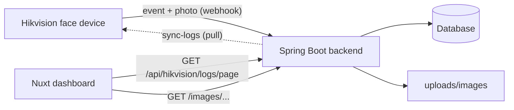

# HikConnect Access Log

A web system that records face-scan check-ins from a **Hikvision** access control device and shows them to HR in a clean, searchable dashboard, with the photo captured at each scan.

## What it does

- **Receives scans in real time.** The Hikvision device pushes an event to the backend every time someone scans their face.
- **Saves who, when and where.** Each scan stores the employee ID, name, scan time, device IP, door number and authentication mode.
- **Keeps the scan photo.** The face image captured by the device is saved on the server and shown next to each record.
- **Avoids duplicates.** A scan with the same employee ID and scan time is stored only once, even if the device sends it again.
- **Syncs past records.** A sync endpoint pulls existing logs from the device, so records can be recovered or backfilled.
- **Gives HR a dashboard.** Search, date filters, paging and a photo viewer, in Thai.

## How it works



1. The device sends a multipart `POST` to `/api/hikvision/receive` containing the event JSON and the photo.
2. The backend keeps only successful face-authentication events (`subEventType` 75), skips duplicates, saves the photo to `uploads/images/` and writes the record to the database.
3. The dashboard asks the backend for pages of records, with optional date range and keyword, and displays them.

## Features

### Backend (Spring Boot)

| Feature | Details |
| --- | --- |
| Webhook receiver | Accepts the device's multipart event, parses the JSON and saves the photo |
| De-duplication | Checks employee ID plus scan time before saving |
| Photo storage | Files go to `uploads/images/` and are served at `/images/**` |
| Paged API | Page, size, date range and keyword search, newest first |
| Device sync | Pulls access logs directly from the device |
| CORS | Allows the Nuxt frontend to call the API from the browser |

### Dashboard (Nuxt / Vue)

- Total number of records at a glance
- Quick date filters: today, yesterday, last 7 days, last 30 days
- Search by employee name or ID, plus custom start and end dates
- Scan time shown large, with date and employee ID beneath
- Click a photo to see it enlarged
- Rows per page (10, 20 or 50) and full pagination controls
- Loading, empty and error states
- Works on phones and desktops
- Thai date format (Buddhist year)

## API

Base path: `/api/hikvision`

| Method | Endpoint | Description |
| --- | --- | --- |
| `POST` | `/receive` | Webhook for the device (multipart: `AccessControllerEvent` JSON and `Picture` file) |
| `GET` | `/sync-logs` | Pull logs from the device and save new ones |
| `GET` | `/logs` | All access logs (not paged) |
| `GET` | `/logs/page` | Paged logs |

`GET /logs/page` parameters:

| Parameter | Default | Description |
| --- | --- | --- |
| `page` | `0` | Page number, starting at 0 |
| `size` | `10` | Rows per page (1–100) |
| `startDate` | none | First day to include, format `yyyy-MM-dd` |
| `endDate` | none | Last day to include (inclusive), format `yyyy-MM-dd` |
| `keyword` | none | Matches employee name or ID |

Example response (trimmed):

```json
{
  "content": [
    {
      "id": 718,
      "employeeId": "2",
      "name": "thep",
      "scanTime": "2026-11-03T11:14:44+07:00",
      "deviceIp": "192.168.10.220",
      "doorNo": 1,
      "authType": "faceOrFpOrCardOrPw",
      "pictureUrl": "http://localhost:9090/images/2_1793690000000.jpg"
    }
  ],
  "totalElements": 718,
  "totalPages": 72
}
```

## Getting started

### Requirements

- Java (version used by the project) and Maven or Gradle
- Node.js 18 or newer
- A Hikvision access control device on the same network as the server
- A database <!-- TODO: add the database you use, for example MySQL or PostgreSQL -->

### 1. Backend

```bash
cd hikconnect-backend
# configure the database and device settings in application.properties
./mvnw spring-boot:run        # or ./gradlew bootRun
```

The backend runs on `http://localhost:9090`.

### 2. Dashboard

```bash
cd frontend
npm install
npm run dev
```

The dashboard runs on `http://localhost:3000`. Pages live in `app/`, and the access log page is `access-logs.vue`.

### 3. Point the device at the backend

In the Hikvision web interface, set up event notification (HTTP listening) to send to:

```
http://<server-ip>:9090/api/hikvision/receive
```

Make sure the server and the device can reach each other, and that the firewall allows port `9090`.

## Configuration

| Setting | Where | Notes |
| --- | --- | --- |
| Backend port | `application.properties` | `9090` |
| Database connection | `application.properties` | <!-- TODO --> |
| Device IP and credentials | `application.properties` | Needed for `/sync-logs` <!-- TODO: confirm property names --> |
| Allowed frontend origin | `@CrossOrigin` in `HikvisionController` | Add your production URL when you deploy |
| Backend URL for the dashboard | `runtimeConfig.public.apiBase` in `nuxt.config.ts` | Defaults to `http://localhost:9090` |
| Photo folder | `uploads/images/` | Back this folder up along with the database |

## Project structure

```
hikconnect-backend/
├── controller/     HikvisionController      REST endpoints and webhook
├── services/       HikvisionService         device sync, paging and search
├── repositories/   AccessLogRepository      database access
├── entities/       AccessLog                one scan record
└── config/         WebConfig                serves uploaded photos

frontend/
└── app/            access-logs.vue          the HR dashboard
```

## Notes

- Face photos are personal data. Keep the server on a private network, restrict who can open the dashboard, and decide how long photos are kept.
- The dashboard currently has no login. Add authentication before exposing it outside your office network.
